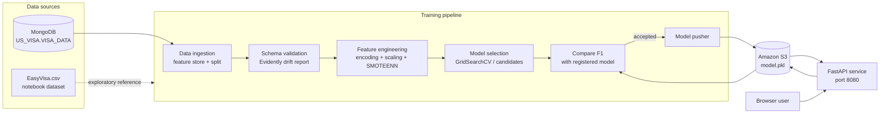
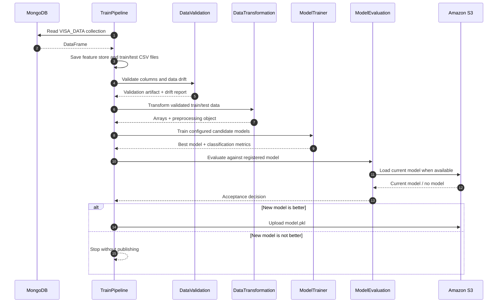
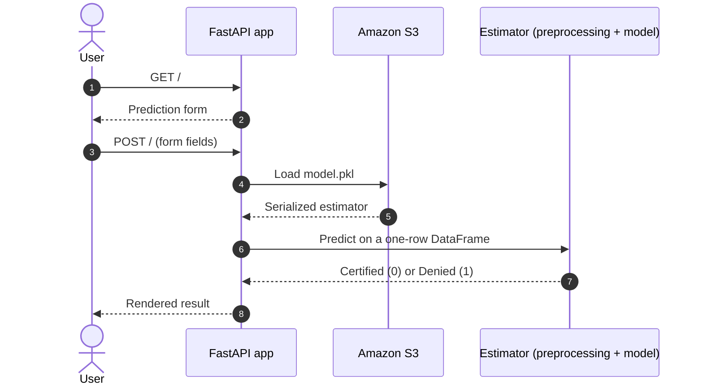
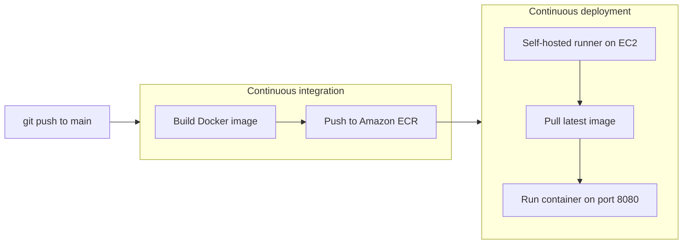

<div align="center">

# 🛂 US Visa MLOps

### End-to-end machine learning for predicting US employment visa case outcomes

*From MongoDB to a live FastAPI prediction service, with validation, drift detection, and an automated model registry in between.*

[](https://www.python.org/)
[](https://fastapi.tiangolo.com/)
[](https://www.docker.com/)
[](https://aws.amazon.com/)
[](https://www.mongodb.com/)
[](https://scikit-learn.org/)
[](https://github.com/features/actions)

[](https://github.com/paras160500/US-VISA-MLOPS-PRODUCTION-READY/stargazers)
[](https://github.com/paras160500/US-VISA-MLOPS-PRODUCTION-READY/network/members)
[](https://github.com/paras160500/US-VISA-MLOPS-PRODUCTION-READY/issues)
[](https://github.com/paras160500/US-VISA-MLOPS-PRODUCTION-READY/commits/main)

[Quick start](#-quick-start) · [Architecture](#-architecture) · [ML pipeline](#-ml-pipeline) · [API](#-api-reference) · [Docker](#-docker) · [CI/CD](#-cicd) · [Troubleshooting](#-troubleshooting) · [Roadmap](#-roadmap)

</div>

> [!IMPORTANT]
> **Project status:** this repository is a production-oriented *reference implementation*. Before using it in a real deployment, review the security, data governance, monitoring, testing, dependency pinning, and model validation requirements for your environment. See [Production hardening checklist](#-production-hardening-checklist).

---

## 📑 Table of contents

- [Overview](#-overview)
- [Key features](#-key-features)
- [Tech stack](#-tech-stack)
- [Architecture](#-architecture)
- [ML pipeline](#-ml-pipeline)
- [Repository structure](#-repository-structure)
- [Prerequisites](#-prerequisites)
- [Quick start](#-quick-start)
- [Configuration](#-configuration)
- [Train a model](#-train-a-model)
- [Run the prediction service](#-run-the-prediction-service)
- [API reference](#-api-reference)
- [Docker](#-docker)
- [CI/CD](#-cicd)
- [Dataset and features](#-dataset-and-features)
- [Artifacts and model registry](#-artifacts-and-model-registry)
- [Notebooks](#-notebooks)
- [Design decisions](#-design-decisions)
- [Testing](#-testing)
- [Production hardening checklist](#-production-hardening-checklist)
- [Troubleshooting](#-troubleshooting)
- [FAQ](#-faq)
- [Roadmap](#-roadmap)
- [Contributing](#-contributing)
- [Security](#-security)
- [License](#-license)
- [Author](#-author)
- [Acknowledgments](#-acknowledgments)

---

## 🎯 Overview

The application learns from historical visa case records and predicts whether a new case will be **Certified** or **Denied**. The target column is `case_status`.

Rather than stopping at a notebook, this project wraps the full machine learning lifecycle in a repeatable, modular pipeline:

| Question | Answer |
| --- | --- |
| **Where does the data come from?** | The `VISA_DATA` collection in the `US_VISA` MongoDB database |
| **How is data quality enforced?** | Schema validation plus Evidently-based drift detection |
| **How is the model chosen?** | Candidate models are searched and ranked by `neuro_mf`, configured in `config/model.yaml` |
| **How does a model reach production?** | It is pushed to Amazon S3 *only if* it beats the currently registered model on F1 |
| **How do users get predictions?** | A FastAPI web form that loads the registered model from S3 |
| **How is it shipped?** | Docker image, GitHub Actions, Amazon ECR, EC2 |

### The workflow at a glance

1. Read records from the `VISA_DATA` collection in the `US_VISA` MongoDB database.
2. Export a feature-store snapshot and create train/test splits.
3. Validate the dataset schema and check for drift between the train and test datasets.
4. Derive `company_age` from `yr_of_estab` and the current calendar year.
5. Encode categorical features, transform numeric features, and rebalance the training data with SMOTEENN.
6. Select and train the best configured candidate model.
7. Compare the new model with the model currently stored in Amazon S3.
8. Push the new model to S3 only when it improves on the currently registered model.
9. Serve predictions through a FastAPI web form.

---

## ✨ Key features

- **Modular pipeline.** Ingestion, validation, transformation, training, evaluation, and publishing are separate components with typed config and artifact entities.
- **Data validation gates.** Column count and required-column checks, plus an Evidently drift report saved as YAML.
- **Config-driven models.** Add or swap candidate models and hyperparameter search spaces in `config/model.yaml` without touching Python code.
- **Champion/challenger promotion.** A new model replaces the registered one only when its F1 score is better.
- **Single deployable estimator.** The preprocessing object and trained model are serialized together, which prevents training/serving skew.
- **Cloud model registry.** Accepted models live in Amazon S3 as `model.pkl`.
- **Web UI and interactive docs.** A browser form for predictions and auto-generated Swagger/ReDoc pages from FastAPI.
- **Containerized and automated.** Dockerfile plus a GitHub Actions workflow that builds, pushes to ECR, and deploys to EC2.
- **Reproducible experiments.** Timestamped artifact directories keep every training run's inputs, reports, and outputs side by side.

---

## 🧰 Tech stack

| Layer | Technology |
| --- | --- |
| Language | Python 3.8+ |
| Data store | MongoDB |
| Data validation and drift | Schema checks, [Evidently](https://www.evidentlyai.com/) |
| Feature engineering | scikit-learn `ColumnTransformer`, one-hot and ordinal encoding, Yeo-Johnson (`PowerTransformer`), `StandardScaler` |
| Imbalance handling | `imbalanced-learn` (`SMOTEENN`) |
| Model selection | `neuro_mf`, with `KNeighborsClassifier` and `RandomForestClassifier` candidates |
| Model registry | Amazon S3 |
| Serving | FastAPI, Uvicorn, Jinja2 templates |
| Packaging | Docker |
| CI/CD | GitHub Actions, Amazon ECR, EC2 (self-hosted runner) |

---

## 🏗 Architecture

### System overview



### Training pipeline sequence



### Prediction flow



---

## 🔬 ML pipeline

| Stage | Implementation | Output |
| --- | --- | --- |
| Ingestion | `DataIngestion` reads MongoDB and performs an 80/20 split | Feature store, train CSV, test CSV |
| Validation | `DataValidation` checks column count, required columns, and drift with Evidently | Validation artifact and YAML drift report |
| Transformation | `ColumnTransformer` with one-hot encoding, ordinal encoding, Yeo-Johnson transformation, and standard scaling | Transformed arrays and `preprocessing.pkl` |
| Rebalancing | `SMOTEENN` | Resampled train/test arrays |
| Training | `neuro_mf` evaluates the candidate models configured in `config/model.yaml` | `model.pkl` and F1/precision/recall metrics |
| Evaluation | Compares the new model's F1 score with the S3 model | Model acceptance decision |
| Publishing | Uploads accepted model to S3 | Registered `model.pkl` |

The current model configuration includes `KNeighborsClassifier` and `RandomForestClassifier`. Update `config/model.yaml` to add or change candidates and search spaces.

### Promotion rule

```text
if no registered model exists:           accept the new model as the initial model
elif new_model.F1 > registered_model.F1: accept and push to S3
else:                                    reject and stop without publishing
```

---

## 📁 Repository structure

```
.
├── .github/workflows/aws.yaml       # Build and deploy workflow
├── config/
│   ├── model.yaml                   # Candidate models and search parameters
│   └── schema.yaml                  # Dataset schema and transformation groups
├── notebook/
│   ├── EasyVisa.csv                 # Local exploratory dataset
│   ├── EDA_US_visa.ipynb            # Exploratory analysis
│   ├── Feature_engineering.ipynb    # Feature engineering experiments
│   └── mongodb_demo.ipynb           # MongoDB data workflow demo
├── static/css/                      # Web UI styles
├── templates/usvisa.html            # Prediction form template
├── us_visa/
│   ├── cloud_storage/               # S3 operations
│   ├── components/                  # Pipeline components
│   ├── configuration/               # MongoDB and AWS clients
│   ├── data_access/                 # MongoDB-to-DataFrame access
│   ├── entity/                      # Config, artifacts, and estimators
│   ├── pipline/                     # Training and prediction pipelines
│   └── utils/                       # Serialization and utility helpers
├── app.py                           # FastAPI application
├── demo.py                          # Training entry point
├── Dockerfile                       # Container image definition
├── requirements.txt                 # Python dependencies
├── setup.py                         # Package configuration
└── template.py                      # Project scaffold generator
```

> [!NOTE]
> The package directory is spelled `pipline` in the current codebase. Imports must use that spelling (`us_visa.pipline.training_pipeline`) until it is renamed.

### Component map

| Component | Responsibility |
| --- | --- |
| `us_visa/components/data_ingestion.py` | Pull data from MongoDB, write the feature store, split train/test |
| `us_visa/components/data_validation.py` | Validate schema and generate the drift report |
| `us_visa/components/data_transformation.py` | Build and apply the preprocessing pipeline and SMOTEENN |
| `us_visa/components/model_trainer.py` | Search candidate models and compute metrics |
| `us_visa/components/model_evaluation.py` | Compare the new model with the S3 model |
| `us_visa/components/model_pusher.py` | Upload the accepted model to S3 |
| `us_visa/cloud_storage/` | Thin wrapper around S3 reads and writes |
| `us_visa/entity/` | Config dataclasses, artifact dataclasses, and the estimator wrapper |

> The component file names above follow the usual layout for this project structure. Check `us_visa/components/` to confirm the exact module names in your checkout.

---

## ✅ Prerequisites

- Python 3.8 or newer
- A MongoDB deployment containing the `US_VISA` database and `VISA_DATA` collection
- An AWS account with an S3 bucket for the model registry
- AWS credentials with permission to read and write the model object
- Docker, if you want to build the container image

The dataset should contain the columns listed in [`config/schema.yaml`](config/schema.yaml), including the target column `case_status`.

### Minimum AWS permissions

The credentials used by the pipeline and the API need access to the model bucket. A least-privilege policy looks like this (replace the bucket name):

```json
{
  "Version": "2012-10-17",
  "Statement": [
    {
      "Effect": "Allow",
      "Action": ["s3:ListBucket"],
      "Resource": "arn:aws:s3:::<your-model-bucket>"
    },
    {
      "Effect": "Allow",
      "Action": ["s3:GetObject", "s3:PutObject"],
      "Resource": "arn:aws:s3:::<your-model-bucket>/*"
    }
  ]
}
```

---

## 🚀 Quick start

```bash
# 1. Clone
git clone https://github.com/paras160500/US-VISA-MLOPS-PRODUCTION-READY.git
cd US-VISA-MLOPS-PRODUCTION-READY

# 2. Create and activate a virtual environment
python -m venv .venv
source .venv/bin/activate        # macOS/Linux
# .venv\Scripts\activate         # Windows PowerShell

# 3. Install dependencies
python -m pip install --upgrade pip
pip install -r requirements.txt

# 4. Configure secrets (see the Configuration section)
cp .env.example .env             # if you create one, otherwise create .env by hand

# 5. Train and publish the first model
python demo.py

# 6. Start the prediction service
uvicorn app:app --host 0.0.0.0 --port 8080 --reload
```

Then open **http://localhost:8080**.

> [!TIP]
> Step 5 must succeed at least once before the web form can return predictions, because the API loads `model.pkl` from S3.

---

## ⚙️ Configuration

Create a local `.env` file in the project root. **Do not commit it.**

```
MONGO_URI=mongodb+srv://<username>:<password>@<cluster>/<database>
AWS_ACCESS_KEY_ID=<your-access-key-id>
AWS_SECRET_ACCESS_KEY=<your-secret-access-key>
AWS_DEFAULT_REGION=us-east-1
```

### Environment variable reference

| Variable | Required | Purpose | Notes |
| --- | --- | --- | --- |
| `MONGO_URI` | Yes | MongoDB connection string | Must be reachable from the machine running the pipeline |
| `AWS_ACCESS_KEY_ID` | Yes | AWS access key for S3 | Prefer IAM roles in production |
| `AWS_SECRET_ACCESS_KEY` | Yes | AWS secret key for S3 | Never commit this value |
| `AWS_DEFAULT_REGION` | Recommended | AWS region | The client defaults to `us-east-1` in `us_visa/constants/__init__.py` |

### Values currently defined in code

| Setting | Current value | Where |
| --- | --- | --- |
| MongoDB database | `US_VISA` | constants |
| MongoDB collection | `VISA_DATA` | constants |
| Model bucket | `paras-usvisa-model2026` | `MODEL_BUCKET_NAME` in constants |
| Model object key | `model.pkl` | constants |
| Train/test split | 80/20 | data ingestion config |
| Target column | `case_status` | `config/schema.yaml` |

> [!WARNING]
> The model bucket is hard-coded as `paras-usvisa-model2026`. Change `MODEL_BUCKET_NAME` before deploying to your own AWS account, or refactor it into an environment variable for safer configuration.

### Keep secrets out of Git

Make sure `.gitignore` contains at least:

```gitignore
.env
.venv/
artifact/
__pycache__/
*.pkl
```

---

## 🏋️ Train a model

Run the complete ingestion-to-publishing pipeline with:

```bash
python demo.py
```

Or run it directly from Python:

```python
from us_visa.pipline.training_pipeline import TrainPipeline

TrainPipeline().run_pipeline()
```

Training artifacts are written below a timestamped directory in `artifact/`. Typical outputs include:

```
artifact/<timestamp>/
├── data_ingestion/
│   ├── feature_store/usvisa.csv
│   └── ingested/{train,test}.csv
├── data_validation/drift_report/report.yaml
├── data_transformation/
│   ├── transformed/{train,test}.npy
│   └── transformed_object/preprocessing.pkl
└── model_trainer/trained_model/model.pkl
```

The pipeline publishes the trained model only when its F1 score is better than the model already registered in S3. If no registered model is available, the new model can be accepted as the initial model.

### Customizing the candidate models

Edit `config/model.yaml` to change what gets searched. The shape follows the `neuro_mf` format, for example:

```yaml
grid_search:
  class: GridSearchCV
  module: sklearn.model_selection
  params:
    cv: 3
    verbose: 2

model_selection:
  module_0:
    class: RandomForestClassifier
    module: sklearn.ensemble
    params:
      min_samples_leaf: 3
    search_param_grid:
      min_samples_leaf: [6, 8, 10]
      n_estimators: [100, 200]
```

Treat this as an illustration of the structure and check the file in your checkout for the exact keys and values in use.

---

## 🌐 Run the prediction service

Start the FastAPI application with Uvicorn:

```bash
uvicorn app:app --host 0.0.0.0 --port 8080 --reload
```

Open [http://localhost:8080](http://localhost:8080) in a browser.

For API exploration, FastAPI also provides interactive documentation at:

- [http://localhost:8080/docs](http://localhost:8080/docs) (Swagger UI)
- [http://localhost:8080/redoc](http://localhost:8080/redoc) (ReDoc)

The prediction service loads `model.pkl` from the configured S3 bucket. Train and publish a model before requesting a prediction.

---

## 📡 API reference

| Method | Path | Description |
| --- | --- | --- |
| `GET` | `/` | Renders the prediction form |
| `POST` | `/` | Accepts form fields and returns a rendered result |
| `GET` | `/train` | Runs the full training pipeline from the service process |
| `GET` | `/docs` | Swagger UI |
| `GET` | `/redoc` | ReDoc |

> [!CAUTION]
> `GET /train` runs a full training job inside the web process and has **no authentication**. Do not expose it publicly. Protect it, move it to a background worker, or remove it before any real deployment.

### Form fields for `POST /`

| Field | Type | Example |
| --- | --- | --- |
| `continent` | string | `Asia` |
| `education_of_employee` | string | `Master's` |
| `has_job_experience` | `Y` / `N` | `Y` |
| `requires_job_training` | `Y` / `N` | `N` |
| `no_of_employees` | integer | `2500` |
| `company_age` | integer (years) | `15` |
| `region_of_employment` | string | `West` |
| `prevailing_wage` | float | `85000.0` |
| `unit_of_wage` | string | `Year` |
| `full_time_position` | `Y` / `N` | `Y` |

### Example request

```bash
curl -X POST http://localhost:8080/ \
  -F "continent=Asia" \
  -F "education_of_employee=Master's" \
  -F "has_job_experience=Y" \
  -F "requires_job_training=N" \
  -F "no_of_employees=2500" \
  -F "company_age=15" \
  -F "region_of_employment=West" \
  -F "prevailing_wage=85000" \
  -F "unit_of_wage=Year" \
  -F "full_time_position=Y"
```

The response is the rendered HTML page containing the predicted status.

### Using the estimator from Python

```python
from us_visa.pipline.prediction_pipeline import USvisaData, USvisaClassifier

data = USvisaData(
    continent="Asia",
    education_of_employee="Master's",
    has_job_experience="Y",
    requires_job_training="N",
    no_of_employees=2500,
    company_age=15,
    region_of_employment="West",
    prevailing_wage=85000,
    unit_of_wage="Year",
    full_time_position="Y",
)

df = data.get_usvisa_input_data_frame()
prediction = USvisaClassifier().predict(dataframe=df)   # 0 = Certified, 1 = Denied
```

> Class and module names above reflect the typical structure of this project. Confirm them against `us_visa/pipline/` and `us_visa/entity/` in your checkout.

---

## 🐳 Docker

Build the image:

```bash
docker build -t us-visa-mlops:latest .
```

Run the service with environment variables supplied at runtime:

```bash
docker run --rm -p 8080:8080 \
  -e MONGO_URI="$MONGO_URI" \
  -e AWS_ACCESS_KEY_ID="$AWS_ACCESS_KEY_ID" \
  -e AWS_SECRET_ACCESS_KEY="$AWS_SECRET_ACCESS_KEY" \
  -e AWS_DEFAULT_REGION="${AWS_DEFAULT_REGION:-us-east-1}" \
  us-visa-mlops:latest \
  uvicorn app:app --host 0.0.0.0 --port 8080
```

The current `Dockerfile` installs the application dependencies but does not define an `ENTRYPOINT` or `CMD`, so the start command must be supplied explicitly as shown above.

### Suggested Dockerfile improvement

Adding a default command and a non-root user makes the image safer and easier to run:

```dockerfile
# Add near the end of the Dockerfile
RUN useradd --create-home appuser
USER appuser
EXPOSE 8080
CMD ["uvicorn", "app:app", "--host", "0.0.0.0", "--port", "8080"]
```

### Using an env file

```bash
docker run --rm -p 8080:8080 --env-file .env us-visa-mlops:latest \
  uvicorn app:app --host 0.0.0.0 --port 8080
```

---

## 🔁 CI/CD

The workflow at [`.github/workflows/aws.yaml`](.github/workflows/aws.yaml) runs on pushes to `main` and contains two stages:



1. **Continuous integration:** builds the Docker image and pushes it to Amazon ECR.
2. **Continuous deployment:** runs on a self-hosted GitHub Actions runner and starts the latest image on an EC2 host.

Configure these GitHub repository secrets before enabling the workflow:

```
AWS_ACCESS_KEY_ID
AWS_SECRET_ACCESS_KEY
AWS_DEFAULT_REGION
ECR_REPO
MONGODB_URL
```

The deployment workflow currently maps the service to port `8080` and injects AWS and MongoDB credentials into the container. For production, prefer:

- short-lived credentials and IAM roles
- encrypted secret management
- image version tags (for example the Git SHA) instead of `latest`
- health checks
- a deployment strategy that supports rollback

### EC2 setup checklist

- [ ] Launch an EC2 instance and install Docker
- [ ] Attach an IAM role with ECR pull and S3 model-bucket permissions
- [ ] Register the instance as a GitHub self-hosted runner
- [ ] Open inbound port `8080` in the security group (restrict the source CIDR)
- [ ] Add the repository secrets listed above
- [ ] Push to `main` and watch the Actions tab

---

## 📊 Dataset and features

The source dataset contains the following columns:

- **Categorical:** `continent`, `education_of_employee`, `has_job_experience`, `requires_job_training`, `region_of_employment`, `unit_of_wage`, `full_time_position`, `case_status`
- **Numeric:** `no_of_employees`, `yr_of_estab`, `prevailing_wage`
- **Identifier:** `case_id`
- **Derived feature:** `company_age = current_year - yr_of_estab`

`case_id` and `yr_of_estab` are dropped before model fitting. The target mapping used by the estimator is:

```
Certified -> 0
Denied    -> 1
```

### Data dictionary

| Column | Type | Description |
| --- | --- | --- |
| `case_id` | identifier | Unique ID of the visa case (dropped before training) |
| `continent` | categorical | Continent of the employee |
| `education_of_employee` | categorical | Education level of the employee |
| `has_job_experience` | categorical (Y/N) | Whether the employee has prior job experience |
| `requires_job_training` | categorical (Y/N) | Whether the role requires job training |
| `no_of_employees` | numeric | Number of employees at the employer |
| `yr_of_estab` | numeric | Year the employer was established (replaced by `company_age`) |
| `region_of_employment` | categorical | US region of intended employment |
| `prevailing_wage` | numeric | Prevailing wage for the role |
| `unit_of_wage` | categorical | Unit of the wage (hour, week, month, year) |
| `full_time_position` | categorical (Y/N) | Whether the position is full-time |
| `case_status` | target | `Certified` or `Denied` |

The authoritative list of columns and transformation groups lives in [`config/schema.yaml`](config/schema.yaml).

### Feature engineering summary

| Feature group | Treatment |
| --- | --- |
| Nominal categoricals | One-hot encoding |
| Ordinal categoricals | Ordinal encoding |
| Skewed numerics | Yeo-Johnson power transform |
| Numerics | Standard scaling |
| Class imbalance | `SMOTEENN` (over-sampling plus cleaning) |

---

## 🗄 Artifacts and model registry

The project uses two storage layers:

- **Local artifacts:** timestamped files under `artifact/` for intermediate datasets, reports, preprocessing objects, and trained models.
- **S3 model registry:** the accepted serialized estimator is stored as `model.pkl` in the configured model bucket.

The serialized estimator contains both the preprocessing object and the trained model, so prediction applies the same transformations used during training.

### Reading the drift report

`data_validation/drift_report/report.yaml` summarizes, per column, whether the train and test distributions differ significantly. Use it to catch ingestion problems early: a flagged column between train and test usually points to a faulty split, a changed source, or a data-collection bug.

---

## 📓 Notebooks

The `notebook/` directory contains exploratory and demonstration work:

| Notebook | Purpose |
| --- | --- |
| `EDA_US_visa.ipynb` | Exploratory analysis of the visa dataset |
| `Feature_engineering.ipynb` | Cleaning and feature derivation experiments |
| `mongodb_demo.ipynb` | MongoDB-related workflow exploration |
| `data_drift_demo_evidently.ipynb` | Evidently drift-monitoring demonstration |

The notebooks are useful for exploration and explanation; the repeatable training path is implemented in `us_visa/pipline/training_pipeline.py`.

---

## 🧠 Design decisions

| Decision | Rationale | Trade-off |
| --- | --- | --- |
| Estimator bundles preprocessing and model | Guarantees identical transforms at train and serve time | Larger artifact; model and preprocessing versions are coupled |
| S3 as model registry | Simple, durable, cheap, easy to access from any host | No built-in versioning or stage metadata unless enabled |
| F1 as the promotion metric | Balances precision and recall on an imbalanced target | Ignores cost asymmetry between false approvals and false denials |
| `neuro_mf` for model search | Declarative candidate models in YAML | Adds a less common dependency |
| Evidently for drift | Rich, readable reports with little code | Train-vs-test drift is not the same as production drift |
| MongoDB as source | Flexible schema, easy to load and update records | Needs a stable export or snapshot for reproducibility |

---

## 🧪 Testing

The repository does not yet ship an automated test suite. A recommended starting layout:

```
tests/
├── unit/
│   ├── test_schema_validation.py
│   ├── test_company_age_feature.py
│   └── test_estimator_predict.py
├── integration/
│   └── test_training_pipeline_small_sample.py
└── api/
    └── test_app_routes.py
```

Suggested tooling:

```bash
pip install pytest pytest-cov httpx
pytest --cov=us_visa --cov-report=term-missing
```

High-value tests to write first:

- schema validation rejects missing or extra columns
- `company_age` is computed correctly for a known year
- the estimator maps `0 -> Certified` and `1 -> Denied`
- the model evaluator rejects a worse model and accepts a better one
- `GET /` returns `200` and `POST /` with valid fields returns a result (mock S3)

---

## 🛡 Production hardening checklist

- [ ] **Pin dependencies** for reproducible builds. The current requirements file contains several unpinned packages.
- [ ] **Add automated tests:** unit, integration, and smoke tests.
- [ ] **Restrict CORS origins** instead of using a wildcard in a public deployment.
- [ ] **Lock down `/train`** with authentication and authorization, or remove it from the web service.
- [ ] **Externalize configuration:** move bucket names, thresholds, database names, and other deployment settings into environment-specific configuration.
- [ ] **Add observability:** structured logs, metrics, model and data-quality monitoring, and alerting.
- [ ] **Revisit resampling on evaluation data.** Evaluation data should normally remain representative of production traffic; synthetic resampling of the test set can inflate metrics.
- [ ] **Protect sensitive data:** access controls, encryption, retention policies, and audit logging for personal and immigration-related records.
- [ ] **Replace long-lived AWS keys** with IAM roles or workload identity.
- [ ] **Add health and readiness endpoints** and a container `HEALTHCHECK`.
- [ ] **Avoid unsafe deserialization risks.** Only load `model.pkl` files from a bucket you fully control, since pickle files can execute code when loaded.

---

## 🩺 Troubleshooting

<details>
<summary><b>The web form returns an error or no prediction</b></summary>

The API loads `model.pkl` from S3. Run `python demo.py` (or call `/train` in a protected environment) first, and confirm the object exists in your model bucket and that your credentials can read it.

</details>

<details>
<summary><b>MongoDB connection fails or times out</b></summary>

- Check that `MONGO_URI` is set and correctly URL-encoded (special characters in passwords must be percent-encoded).
- If you use MongoDB Atlas, add your machine's IP (or the EC2 instance's IP) to the Atlas network access list.
- Confirm the `US_VISA` database and `VISA_DATA` collection exist and contain documents.

</details>

<details>
<summary><b><code>NoCredentialsError</code> or <code>AccessDenied</code> from S3</b></summary>

- Verify `AWS_ACCESS_KEY_ID` and `AWS_SECRET_ACCESS_KEY` are exported in the shell or passed to Docker.
- Make sure the IAM identity has `s3:GetObject`, `s3:PutObject`, and `s3:ListBucket` on your bucket.
- Confirm `MODEL_BUCKET_NAME` points to a bucket in your account, not the default one in the code.

</details>

<details>
<summary><b>Training finishes but no model is published</b></summary>

This is expected when the new model's F1 does not beat the registered model. Check the logs for the comparison result, or temporarily use a fresh bucket to register an initial model.

</details>

<details>
<summary><b>Validation fails because of columns or drift</b></summary>

Compare the data in MongoDB against [`config/schema.yaml`](config/schema.yaml). Open `data_validation/drift_report/report.yaml` to see which columns drifted.

</details>

<details>
<summary><b><code>ModuleNotFoundError: us_visa</code></b></summary>

Run commands from the repository root and install the package in editable mode:

```bash
pip install -e .
```

</details>

<details>
<summary><b>The Docker container starts and immediately exits</b></summary>

The Dockerfile has no default `CMD`. Pass the Uvicorn command explicitly, or add a `CMD` as described in [Docker](#-docker).

</details>

<details>
<summary><b>Dependency conflicts during <code>pip install</code></b></summary>

Several packages are unpinned. Use a fresh virtual environment, and once you have a working set, freeze it with `pip freeze > requirements.lock.txt` for reproducible installs.

</details>

---

## ❓ FAQ

**Is this a real tool for predicting visa outcomes?**
No. It is an educational and reference MLOps project built on a public-style dataset. Predictions should never be used to make or influence real immigration decisions or advice.

**Why F1 instead of accuracy?**
The target is imbalanced, so accuracy can look high while the model misses the minority class. F1 balances precision and recall.

**Can I use a different database or storage backend?**
Yes. Ingestion is isolated in `us_visa/data_access/` and storage in `us_visa/cloud_storage/`. Swapping MongoDB or S3 means replacing those layers while keeping the component interfaces.

**Can I add XGBoost, LightGBM, or other models?**
Yes. Add a new `module_N` entry to `config/model.yaml` with its class, module path, and search grid, and make sure the package is in `requirements.txt`.

**Does training run automatically?**
Not by default. Training runs when you execute `demo.py` or call `/train`. A scheduler such as cron, GitHub Actions `schedule`, Airflow, or AWS EventBridge can trigger it periodically.

---

## 🗺 Roadmap

- [ ] Add automated tests and coverage reporting
- [ ] Add a health/readiness endpoint and container health check
- [ ] Replace long-lived AWS keys with IAM roles or workload identity
- [ ] Version models and datasets in the registry
- [ ] Add CI checks for linting, type checking, security scanning, and dependency vulnerabilities
- [ ] Add authenticated JSON prediction endpoints alongside the HTML form
- [ ] Add production monitoring for data drift, prediction distribution, latency, and model performance
- [ ] Move all hard-coded settings to environment-based configuration
- [ ] Rename the `pipline` package to `pipeline`
- [ ] Add explainability (for example SHAP) to show which features drove a prediction
- [ ] Add scheduled retraining with a drift-triggered option
- [ ] Publish a model card documenting intended use, metrics, and limitations

---

## 🤝 Contributing

Contributions, issues, and ideas are welcome.

1. Fork the repository
2. Create a feature branch: `git checkout -b feature/your-feature`
3. Make your changes and add tests where possible
4. Commit with a clear message: `git commit -m "feat: add your feature"`
5. Push the branch: `git push origin feature/your-feature`
6. Open a pull request describing what changed and why

Suggested conventions:

- follow [PEP 8](https://peps.python.org/pep-0008/) and format with `black` and `isort`
- use [Conventional Commits](https://www.conventionalcommits.org/) (`feat:`, `fix:`, `docs:`, `chore:`)
- keep pull requests focused and small
- never commit secrets, datasets containing personal data, or trained model binaries

---

## 🔐 Security

- Never commit `.env` files or credentials. If a key is ever committed, **rotate it immediately**; deleting it from history is not enough.
- Treat all visa and immigration data as sensitive personal data.
- Report vulnerabilities privately to the maintainer instead of opening a public issue.

---

## 📄 License

No license file is currently included. Add a `LICENSE` file before distributing or reusing this project, and confirm the dataset and any third-party assets permit the intended use. Common choices are [MIT](https://choosealicense.com/licenses/mit/) and [Apache-2.0](https://choosealicense.com/licenses/apache-2.0/).

---

## 👤 Author

**Paras**
GitHub: [@paras160500](https://github.com/paras160500)

If this project helped you, consider giving it a ⭐ on GitHub.

---

## 🙏 Acknowledgments

- The [EasyVisa dataset](https://www.kaggle.com/) used for exploration and experimentation
- [FastAPI](https://fastapi.tiangolo.com/), [scikit-learn](https://scikit-learn.org/), [imbalanced-learn](https://imbalanced-learn.org/), and [Evidently](https://www.evidentlyai.com/)
- The open-source MLOps community for the patterns this project builds on

<div align="center">

**Built with ❤️ for learning and sharing MLOps**

</div>
